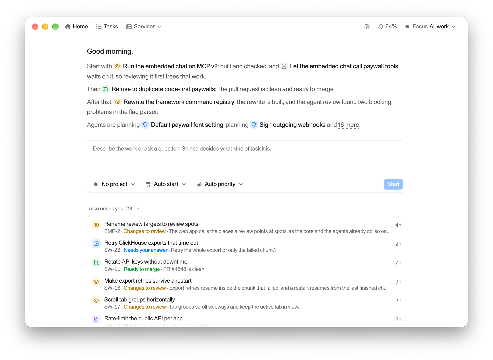

<div align="center">
  <a href="https://shinsa.dev">
    
  </a>

  <h3 align="center">Shinsa</h3>
  <b>Hand over the work. Keep the decisions.</b>
</div>

<p align="center">
    <a href="https://shinsa.dev"><strong>Learn more »</strong></a>
    <br />
    <br />
    <a href="#introduction">Introduction</a>
    ·
    <a href="#how-it-works">How it works</a>
    ·
    <a href="#download">Download</a>
    ·
    <a href="#development">Development</a>
</p>

<p>
  <a href="https://shinsa.dev">
    <picture>
      <source media="(prefers-color-scheme: dark)" srcset="./.github/assets/shinsa-dark.png" />
      
    </picture>
  </a>
</p>

## Introduction

Shinsa runs Claude Code and Codex on your own machine, from your request to a merged pull request. You describe the
work or ask a question. Shinsa decides what kind of task it is, gives it its own agent, worktree and branch, and
carries it through planning, building, checks and review. Agents find out what they can on their own and ask you only
for what is yours to decide: the review, the merge, a call they cannot make, and the plan when you want to approve it.

Shinsa (審査) means examination, judging. Agents do the work end to end; the judging stays yours.

## How it works

- **Gates, not chats.** A task stops for you only at a gate. Everything between gates is Shinsa's job, and you work
  down one list in the order things need you.
- **The right path for each request.** A question gets an answer, a bug gets a diagnosis first, an operation waits
  for your OK, and only a change ends in a pull request. You never pick a mode.
- **Review the change, not the diff.** The agent hands over a work report, phase by phase, pointing at the lines
  that need your eyes, ranked by risk. A second agent reviews it first, with fresh context.
- **Checked without you.** Shinsa runs your repository's own checks itself, and failing CI and review-bot comments go
  back to the agent that built the change.
- **Nothing reaches main without you.** Agents never commit, push or merge. Shinsa does, after your review and your
  merge, and every command an agent runs is checked before it runs.
- **Your setup comes along.** Your Claude Code and Codex accounts, and the MCP servers, skills and plugins you
  already use, load for every agent. When one account hits its limit, the next one takes over.

## Download

Shinsa is a Mac app for Apple Silicon: [shinsa.dev/download](https://shinsa.dev/download) always fetches the latest
release. It needs git, the GitHub CLI signed in (`gh auth login`) and Claude Code signed in; Codex is optional.

Open it and it sets up its engine in the background: agents and schedules keep running when the window is closed or
the app is quit, and the app updates itself. Shinsa → Install the shinsa Command… adds `shinsa` to your terminal:
`shinsa .` opens Shinsa on the project you are in, and `shinsa do "…"` hands it work.

## Development

You need [Bun](https://bun.sh), git, the GitHub CLI and Claude Code.

```sh
bun install
bun dev
```

`bun dev` starts Shinsa's engine on :5180 and the interface on http://localhost:5181. A short setup chat asks which
folders hold your repositories; then describe the first task. To work on the Mac app, run `bun run dev` in
`apps/desktop` while `bun dev` is running. Keep a scratch data directory while developing:
`SHINSA_HOME=/tmp/shinsa-dev bun dev`.

```
apps/
├── server/     The engine: agents, the event log, git, GitHub, and the shinsa command line
├── web/        The interface
├── desktop/    The Mac app
└── marketing/  shinsa.dev

packages/
├── core/       The domain: commands, events and the task lifecycle, pure and fully tested
└── ui/         The design system
```

| Command | Description |
| --- | --- |
| `bun dev` | Start the engine and the interface |
| `bun run test` | Run every unit suite, at 100% coverage |
| `bun lint` | Biome, the repository's conventions checker and spelling |
| `bun check-types` | TypeScript across every package |
| `bun format:fix` | Format |

How Shinsa works inside is in [`docs/`](docs): start with [`docs/spec.md`](docs/spec.md).

## License

[MIT](LICENSE)
